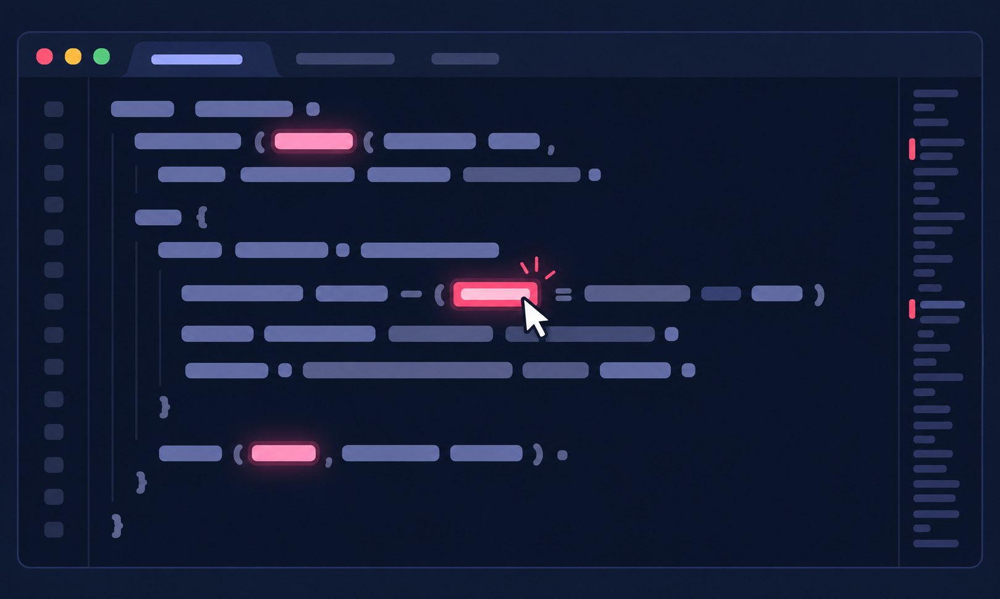
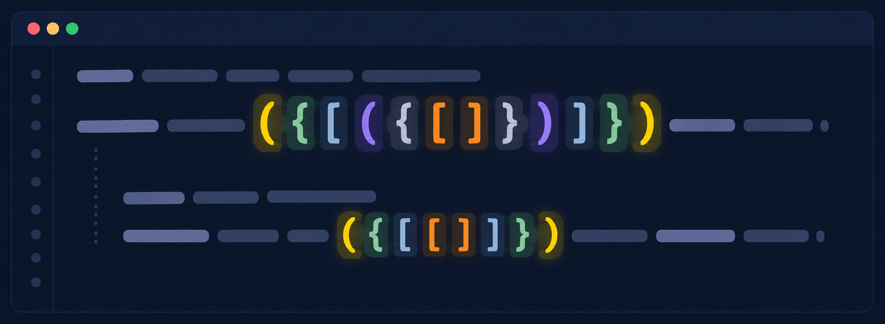

# Word and Selection Highlighter

Highlights the word under the cursor and displays matching occurrences in the editor and overview ruler.



## Settings

On activation, the extension checks these global VS Code settings and updates any missing or different value to disable overlapping built-in highlights:

```json
{
  "editor.selectionHighlight": false,
  "editor.occurrencesHighlight": "off",
  "editor.matchBrackets": "never"
}
```



The extension's bracket pair highlighting can be disabled with the `matchBrackets` setting:

```json
{
  "word-selection-highlighter.matchBrackets": false
}
```

The selection highlight and matching-word overview ruler colors can be customized with color settings:

```json
{
  "word-selection-highlighter.selectionColor": "#FFB3C7",
  "word-selection-highlighter.rulerColor": "#FF99B4"
}
```

Restarting VS Code is not required after changing these settings.
